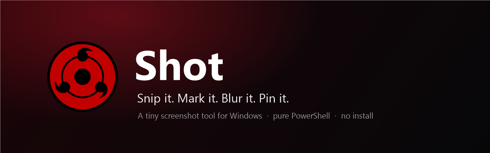
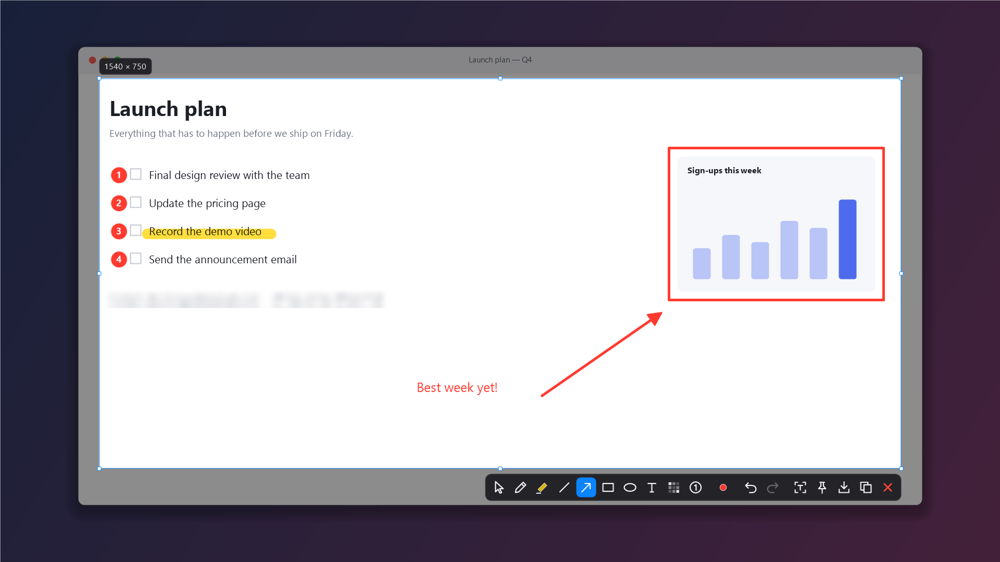
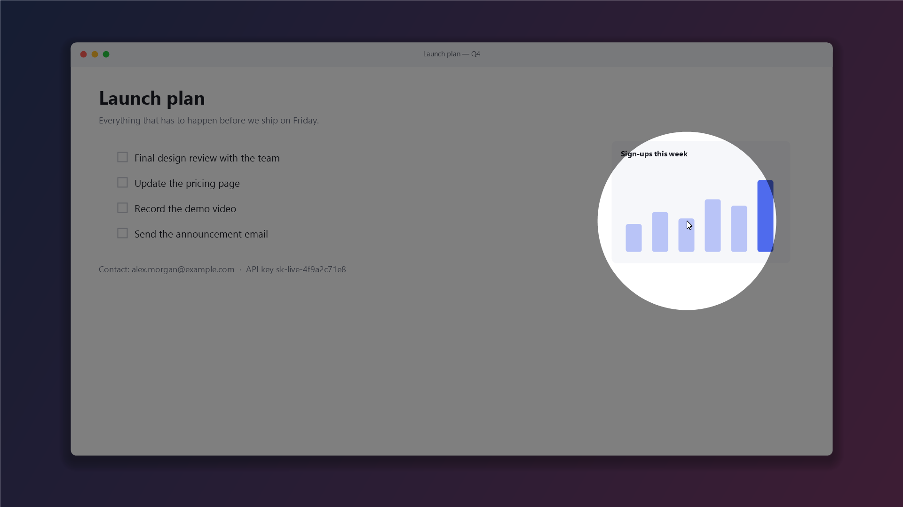
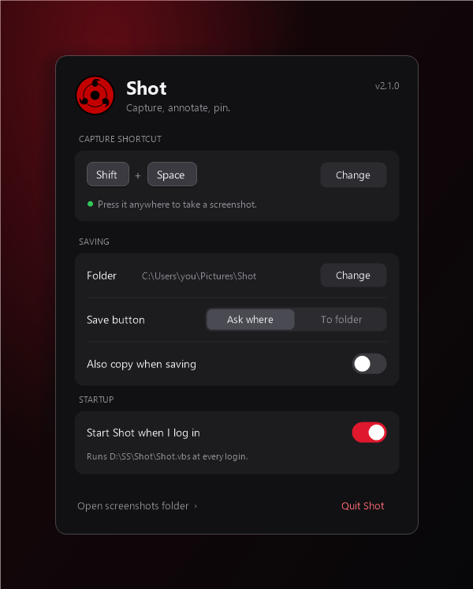

<p align="center">
  
</p>

<p align="center">
  <a href="https://github.com/boode-hub/Shot/releases/latest"></a>
  <a href="#get-started"></a>
  <a href="#how-it-works"></a>
  <a href="#get-started"></a>
  <a href="LICENSE"></a>
</p>

<p align="center">
  <a href="https://buymeacoffee.com/boode"></a>
</p>

<p align="center">
  
</p>

## Why Shot

| | |
|---|---|
| 📦 **Portable** | Two files you can read: `Shot.ps1` and `Shot.vbs`. No installer, no `.exe`, no admin rights. Settings stay in a `data` folder beside them, so it runs from anywhere, even a USB stick. |
| ⚡ **Instant** | Press **Shift + Space** and the screen freezes under your cursor. Drag, or click a window to take just that window. |
| ✏️ **Mark it up** | Pen, highlighter, line, arrow, box, ellipse, text, blur and numbered steps, in 8 quick colours or **any colour** from the full colour panel. |
| 📌 **Pin anything** | Keep a screenshot floating above every window while you read from it, type from it or compare. |
| 🔤 **Copy the text** | Turn a screenshot into text with the OCR engine built into Windows. |
| 🔦 **Spotlight** | Double-tap **Ctrl**: the screen dims and a circle of light follows your cursor. Made for demos and screen shares. |
| 🔒 **Private** | Blur what others should not see. Shot never connects to the internet. |

## Get started

1. **Download** `Shot-x.y.z.zip` from the [latest release](https://github.com/boode-hub/Shot/releases/latest) and extract
   it anywhere (or `git clone https://github.com/boode-hub/Shot`).
2. **Double-click `Shot.vbs`.** The Settings window opens the first time, and the red eye appears in the tray.
3. **Press Shift + Space**, drag over what you want, mark it up, then copy, save or pin it.

Turn on **Start Shot when I log in** in Settings to keep it running: it adds this folder's `Shot.vbs` to
your start-up apps (the per-user Run key, no admin needed). Turn it off to remove it. If you move the
folder, turn it off and on again.

To update, extract the new release over the old folder (your `data` folder stays), or run `git pull`.

> [!TIP]
> If Windows blocks a downloaded copy, right-click the ZIP **before** extracting, choose **Properties**,
> tick **Unblock**, then extract. A copy you get with `git clone` is not marked as downloaded.

## Spotlight

<p align="center">
  
</p>

Double-tap **Ctrl** anywhere and everything goes half dark except a circle around the cursor, which
follows it across every screen. Clicks pass straight through, so you keep working while it is on.
Double-tap **Ctrl** again or press **Esc** to turn it off. Ctrl shortcuts (Ctrl + C, Ctrl + click) never
trigger it, and it gets out of the way when you take a screenshot.

## Shortcuts

**Capture**: drag to select, **click** a window to take just that window, **Ctrl + A** for the whole
screen, or **Ctrl + C** straight away to copy what is highlighted. Drag the selection or use the arrow keys
to move it, and the handles to resize it.

| Tool | Key | | Tool | Key |
|---|:-:|---|---|:-:|
| Move / resize | **V** | | Rectangle | **R** |
| Pen | **P** | | Ellipse | **E** |
| Highlighter | **H** | | Text | **T** |
| Line | **L** | | Blur | **B** |
| Arrow | **A** | | Numbered steps | **N** |

Colours **1–8**, or **0** (the colour wheel in the palette) for any colour: the full Windows colour panel
with a spectrum, RGB / HSL values and 16 custom slots Shot remembers · size **mouse wheel** or **[ ]** ·
hold **Shift** for straight lines, squares and circles · **Ctrl + Z / Ctrl + Y** undo and redo.

| Finish | Keys |
|---|---|
| Copy | **Ctrl + C**, **Enter**, or double-click |
| Save | **Ctrl + S** (quick save to the folder: **Ctrl + Shift + S**) |
| Pin to the screen | **Ctrl + P** or **F3** |
| Copy the text (OCR) | **Ctrl + T** |
| Cancel | **Esc** or right-click |

**Pins** stay on top: drag to move, **wheel** to zoom, **0** for actual size, **Ctrl + C / S / T** to copy,
save or copy the text, **Esc** or double-click to close, right-click for a menu.

## Settings



Open them from the tray icon, or double-click `Shot.vbs` again while Shot runs.

- **Capture shortcut**: click **Change** and press the keys.
- **Saving**: the screenshots folder, whether Save asks where or saves straight to the folder, and
  whether saving also copies.
- **Startup**: start Shot when you log in.

A global shortcut belongs to Shot everywhere, so while Shot runs, Shift + Space no longer types a space in
other apps. If that gets in the way, pick something else, for example Print Screen or Ctrl + Shift + S.

<br clear="right">

## How it works

`Shot.ps1` holds the whole app. Each time it starts, Windows PowerShell 5.1 compiles the C# inside it in
memory (with the .NET Framework that ships with Windows) and runs it: WinForms windows, GDI+ drawing, the
Windows OCR engine. `Shot.vbs` only starts it without a console window. Start-up takes about two seconds.

```
Shot.vbs                              double-click to run (no console window)
powershell -File Shot.ps1 -Capture    run and capture right away
powershell -File Shot.ps1 -Settings   run and open Settings
powershell -File Shot.ps1 -Test       self-check: prints ok or what failed
```

## Support

Shot is free and always will be. If it saves you time, a coffee keeps it going. ☕

<p align="center">
  <a href="https://buymeacoffee.com/boode"></a>
</p>

## License

[MIT](LICENSE) © 2026 boode-hub
